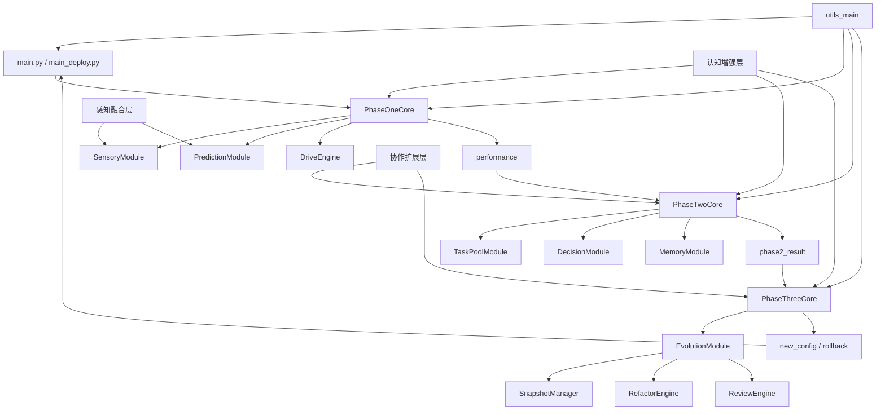

# 架构文档

## 概述

自驱永续进化 Agent 采用**三阶段闭环架构**，每一阶段对应一组核心模块，模块之间通过标准化字典结果传递数据。系统同时按功能划分为四个层次：

- **基础闭环层**：Phase 1 / Phase 2 / Phase 3
- **认知增强层**：学习、因果、元学习、对抗、验证、抽象、伦理
- **协作扩展层**：多 Agent、外部集成、安全、运维、共识、社交
- **感知融合层**：多模态、模拟推演、神经符号、自主目标
- **基础设施层**：日志、异常、验证、配置、接口标准、部署服务

---

## 目录结构

采用满二叉树目录规范，所有源码位于 `root/left/app/left/src/`。

```
root/left/app/left/src/
├── core_mod/        # 29 个已实现核心模块 + 1 个预留扩展槽位
├── utils_main/      # 基础设施模块
├── main.py          # 开发入口
├── main_deploy.py   # 生产入口
└── deploy_server.py # HTTP 部署服务
```

---

## 三阶段闭环

### Phase 1：基础自驱闭环

| 步骤 | 模块 | 输出 |
|:---|:---|:---|
| 感知 | `SensoryModule` | `state`（系统指标、特征向量、时间戳） |
| 预测 | `PredictionModule` | `predictions`（低/中/高三层预测结果） |
| 驱力 | `DriveEngine` | `drive_state`（缺口、权重、场景、总奖励） |
| 性能评估 | `PhaseOneCore` | `performance`（综合性能得分） |

Phase 1 负责持续感知环境、预测未来状态，并计算自驱动力缺口。缺口永远不为零，因此系统永远具备自驱演进动力。

### Phase 2：完整自主闭环

| 步骤 | 模块 | 输出 |
|:---|:---|:---|
| 任务生成 | `TaskPoolModule` | 按安全、收益、能效缺口生成任务 |
| 决策 | `DecisionModule` | `decision`（是否探索、选中任务、可用资源） |
| 记忆 | `MemoryModule` | SQLite 持久化 + 内存缓存 |
| 执行 | `SelfEvolvingAgent` / `ProductionAgent` | 任务状态更新 |

Phase 2 在 Phase 1 的驱力基础上生成任务，通过 70% 利用 + 30% 探索机制做出决策，并将状态写入记忆。

### Phase 3：进化与回滚闭环

| 步骤 | 模块 | 输出 |
|:---|:---|:---|
| 快照保存 | `SnapshotManager` | 保留历史最佳配置快照 |
| 进化分析 | `RefactorEngine`、`FeatureEngine`、`ReviewEngine` | 是否调整、新配置、Gap |
| 回滚判断 | `EvolutionModule` | `should_rollback` |
| 配置应用 | `PhaseThreeCore` | `new_config` |

Phase 3 监控性能历史，当检测到性能衰退或预测 Gap 过大时，自动调整配置；若性能下降超过阈值，则回滚到最佳快照。

---

## 数据流

```
┌──────────────┐     state      ┌──────────────┐
│              │ ─────────────> │              │
│   Sensory    │                │  Prediction  │
│   Module     │ <───────────── │   Module     │
│              │   predictions  │              │
└──────────────┘                └──────────────┘
       │                                │
       │ state                          │ avg_error
       v                                v
┌──────────────┐                ┌──────────────┐
│   Drive      │                │  PhaseOne    │
│   Engine     │ ─drive_state─> │   Core       │
└──────────────┘                └──────────────┘
                                        │
                                        │ phase1_result
                                        v
                               ┌──────────────┐
                               │  PhaseTwo    │
                               │   Core       │
                               └──────────────┘
                               /      |      \
                              /       |       \
                    task_pool   decision   memory
                              \       |       /
                               \      |      /
                                \     |     /
                                 \    |    /
                                  \   |   /
                                   \  |  /
                                    \ | /
                                     v
                               ┌──────────────┐
                               │  PhaseThree  │
                               │   Core       │
                               └──────────────┘
                                        │
                                        │ new_config / rollback
                                        v
                               ┌──────────────┐
                               │  Agent Main  │
                               │  Loop        │
                               └──────────────┘
```

---

## 模块交互图（Mermaid）



---

## 分层详细设计

### 认知增强层

```
┌─────────────────────────────────────────┐
│            认知增强层                    │
├─────────────────────────────────────────┤
│  learn.py    : 增量 SGD + 自动特征工程  │
│  causal.py   : 因果图 + 反事实分析      │
│  meta.py     : 任务嵌入 + 迁移学习      │
│  adversarial.py : 对抗训练 + 纳什均衡   │
│  verify.py   : 安全不变式 + 决策追踪    │
│  abstract.py : 分层概念形成             │
│  alignment.py: 价值对齐 + 公平审计      │
└─────────────────────────────────────────┘
```

### 协作扩展层

```
┌─────────────────────────────────────────┐
│            协作扩展层                    │
├─────────────────────────────────────────┤
│  collab.py   : 消息总线 + Gossip 协议   │
│  external.py : HTTP 客户端 + MQ + FS    │
│  security.py : 输入消毒 + 速率限制      │
│  ops.py      : 健康检查 + 指标 + 热更新 │
│  consensus.py: Raft-like + BFT          │
│  social.py   : 情感识别 + 关系追踪      │
└─────────────────────────────────────────┘
```

### 感知融合层

```
┌─────────────────────────────────────────┐
│            感知融合层                    │
├─────────────────────────────────────────┤
│  multimodal.py : 跨模态编码与融合       │
│  simulate.py   : 沙箱推演 + 风险评估    │
│  hybrid.py     : 神经符号混合推理       │
│  autonomous.py : 自主目标与动机涌现     │
│  selfaware.py  : 自我模型与元认知       │
│  lifelong.py   : 终身学习与遗忘防护     │
└─────────────────────────────────────────┘
```

### 基础设施层

```
┌─────────────────────────────────────────┐
│            基础设施层                    │
├─────────────────────────────────────────┤
│  interfaces.py : ModuleProtocol + DI    │
│  exceptions.py : 严格异常层次           │
│  constants.py  : 枚举常量               │
│  validators.py : 输入验证 + 配置验证    │
│  logger.py     : 单例日志器             │
│  config_loader.py : YAML 配置加载       │
└─────────────────────────────────────────┘
```

---

## 核心模块职责

### 感知模块 (sensory)

- `SystemCollector`：通过 psutil 采集 CPU、内存指标
- `StateNormalizer`：Welford 在线均值方差标准化
- `NoiseFilter`：EMA 平滑去噪
- `SensoryModule`：统一感知入口

### 驱力引擎 (drive)

- `SafeDriveCalculator`：安全驱力（风险越低越高）
- `GainDriveCalculator`：收益驱力（预测误差趋势）
- `EffDriveCalculator`：能效驱力（系统负载）
- `DynamicWeightAdjuster`：根据奖励动态调整三驱力权重
- `ScenarioDetector`：识别 emergency / resource_tight / stable_idle / normal 场景

### 预测模块 (predict)

- `LowLevelPredictor`：EMA + 趋势预测
- `MidLevelPredictor`：岭回归窗口预测
- `HighLevelPredictor`：K-Means 聚类状态识别

### 任务池 (task)

- `TaskPool`：优先级队列、过期清理、失败重试
- `SafeTaskGenerator` / `GainTaskGenerator` / `EffTaskGenerator`：按缺口生成任务

### 决策模块 (decide)

- `ExplorationController`：维护 30% 探索率
- `TaskSelector`：基于缺口加权优先级排序
- `ResourceBalancer`：检查 CPU / Memory 资源限制

### 记忆模块 (memory)

- `SQLiteStore`：线程安全 SQLite 持久化
- `StateCache`：内存缓存与最近状态查询

### 进化模块 (evolve)

- `SnapshotManager`：保存/裁剪/回滚配置快照
- `RefactorEngine`：检测高误差或性能停滞
- `FeatureEngine`：计算预测 Gap 并提出功能增强
- `ReviewEngine`：审批配置调整

---

## 模块映射表

| 层级 | 模块 | 文件 | 所属阶段 | 关键类 |
|:---|:---|:---|:---|:---|
| 基础闭环 | 环境感知 | [core_mod/sensory.py](../../left/src/core_mod/sensory.py) | Phase 1 | `SensoryModule` |
| 基础闭环 | 驱力引擎 | [core_mod/drive.py](../../left/src/core_mod/drive.py) | Phase 1 | `DriveEngine` |
| 基础闭环 | 预测模块 | [core_mod/predict.py](../../left/src/core_mod/predict.py) | Phase 1 | `PredictionModule` |
| 基础闭环 | Phase 1 核心 | [core_mod/phase_one.py](../../left/src/core_mod/phase_one.py) | Phase 1 | `PhaseOneCore` |
| 基础闭环 | 任务池 | [core_mod/task.py](../../left/src/core_mod/task.py) | Phase 2 | `TaskPoolModule` |
| 基础闭环 | 决策模块 | [core_mod/decide.py](../../left/src/core_mod/decide.py) | Phase 2 | `DecisionModule` |
| 基础闭环 | 记忆模块 | [core_mod/memory.py](../../left/src/core_mod/memory.py) | Phase 2 | `MemoryModule` |
| 基础闭环 | Phase 2 核心 | [core_mod/phase_two.py](../../left/src/core_mod/phase_two.py) | Phase 2 | `PhaseTwoCore` |
| 基础闭环 | 进化模块 | [core_mod/evolve.py](../../left/src/core_mod/evolve.py) | Phase 3 | `EvolutionModule` |
| 基础闭环 | Phase 3 核心 | [core_mod/phase_three.py](../../left/src/core_mod/phase_three.py) | Phase 3 | `PhaseThreeCore` |
| 认知增强 | 自适应学习 | [core_mod/learn.py](../../left/src/core_mod/learn.py) | 增强 | `AdaptiveLearner` |
| 认知增强 | 因果推理 | [core_mod/causal.py](../../left/src/core_mod/causal.py) | 增强 | `CausalModule` |
| 认知增强 | 元学习 | [core_mod/meta.py](../../left/src/core_mod/meta.py) | 增强 | `MetaLearner` |
| 认知增强 | 对抗鲁棒性 | [core_mod/adversarial.py](../../left/src/core_mod/adversarial.py) | 增强 | `AdversarialModule` |
| 认知增强 | 形式化验证 | [core_mod/verify.py](../../left/src/core_mod/verify.py) | 增强 | `VerificationModule` |
| 认知增强 | 分层抽象 | [core_mod/abstract.py](../../left/src/core_mod/abstract.py) | 增强 | `AbstractionModule` |
| 认知增强 | 价值对齐 | [core_mod/alignment.py](../../left/src/core_mod/alignment.py) | 增强 | `AlignmentModule` |
| 协作扩展 | 多 Agent 协作 | [core_mod/collab.py](../../left/src/core_mod/collab.py) | 扩展 | `CollaborationModule` |
| 协作扩展 | 外部系统集成 | [core_mod/external.py](../../left/src/core_mod/external.py) | 扩展 | `ExternalIntegrationModule` |
| 协作扩展 | 安全边界 | [core_mod/security.py](../../left/src/core_mod/security.py) | 扩展 | `SecurityModule` |
| 协作扩展 | 运维监控 | [core_mod/ops.py](../../left/src/core_mod/ops.py) | 扩展 | `OpsModule` |
| 协作扩展 | 分布式共识 | [core_mod/consensus.py](../../left/src/core_mod/consensus.py) | 扩展 | `DistributedStateModule` |
| 协作扩展 | 社交智能 | [core_mod/social.py](../../left/src/core_mod/social.py) | 扩展 | `SocialIntelligenceModule` |
| 感知融合 | 跨模态感知融合 | [core_mod/multimodal.py](../../left/src/core_mod/multimodal.py) | 融合 | `SensorFusionModule` |
| 感知融合 | 复杂环境模拟 | [core_mod/simulate.py](../../left/src/core_mod/simulate.py) | 融合 | `SimulationModule` |
| 感知融合 | 神经符号混合推理 | [core_mod/hybrid.py](../../left/src/core_mod/hybrid.py) | 融合 | `HybridInferenceModule` |
| 感知融合 | 自主目标生成 | [core_mod/autonomous.py](../../left/src/core_mod/autonomous.py) | 融合 | `AutonomousGoalModule` |
| 感知融合 | 自我建模 | [core_mod/selfaware.py](../../left/src/core_mod/selfaware.py) | 融合 | `SelfAwarenessModule` |
| 感知融合 | 终身学习 | [core_mod/lifelong.py](../../left/src/core_mod/lifelong.py) | 融合 | `LifelongLearningModule` |
| 扩展槽位 | 自定义模块 | `core_mod/` | 任意 | 继承 `BaseModule` |

## 配置与模块映射

配置文件按环境划分：

| 环境 | 文件路径 | 用途 |
|:---|:---|:---|
| dev | [cfg/left/dev/dev.yaml](../cfg/left/dev/dev.yaml) | 开发调试，循环间隔 1.0s，最大 1000 轮 |
| test | [cfg/left/dev/test.yaml](../cfg/left/dev/test.yaml) | 单元测试，循环间隔 0.1s，最大 100 轮 |
| prod | [cfg/right/prd/prod.yaml](../cfg/right/prd/prod.yaml) | 生产部署，循环间隔 5.0s，HTTP 健康检查启用 |

`ConfigLoader` 将 `{environment}` 映射为 `cfg/left/dev/{environment}.yaml`。生产部署前请确保 `prod.yaml` 已复制或链接到该路径，否则 `AGENT_ENV=prod` 启动会提示配置文件不存在。

## 模块接口标准

所有核心模块遵循 `ModuleProtocol`：

| 方法 | 签名 | 说明 |
|:---|:---|:---|
| 初始化 | `__init__(config: Dict[str, Any])` | 注入该模块专属配置子树 |
| 获取状态 | `get_state() -> Dict[str, Any]` | 返回可序列化的当前状态 |
| 重置 | `reset() -> None` | 恢复到初始状态 |
| 健康检查 | `health_check() -> bool` | 返回模块是否健康 |

通过 `ModuleRegistry` + `DIContainer` + `ConfigAssembler` 实现插件化组装，详见 [`utils_main/interfaces.py`](../../left/src/utils_main/interfaces.py)。
